<p align="center"></p>

# Optimaxer

**[Website](https://bliper2.github.io/optimaxer/)** · [Download](https://github.com/bliper2/optimaxer/releases/latest) · [Privacy](https://bliper2.github.io/optimaxer/privacy.html) · [Terms](https://bliper2.github.io/optimaxer/terms.html) · MIT licensed

Windows 10/11 performance, privacy, debloat and app-install toolkit. WPF GUI in Windows PowerShell 5.1, inspired by the layout of [Chris Titus Tech's WinUtil](https://github.com/ChrisTitusTech/winutil) (MIT), rebuilt with undo support, verification and a lot more tweaks. Many settings, app lists and scripts are adapted from WinUtil and [Win11Debloat](https://github.com/Raphire/Win11Debloat) (MIT); see [THIRD-PARTY-NOTICES.md](THIRD-PARTY-NOTICES.md).

## Screenshots

**Orion Store + Optimaxer** (the Rust desktop app, Windows 11 style with your system accent colour, dark and light):

| | |
|---|---|
| 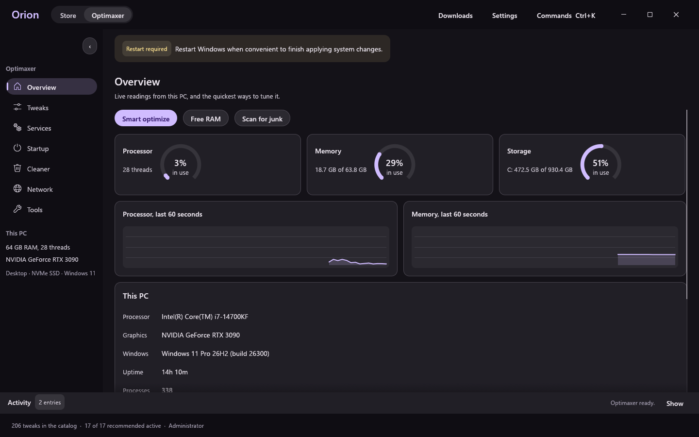 | 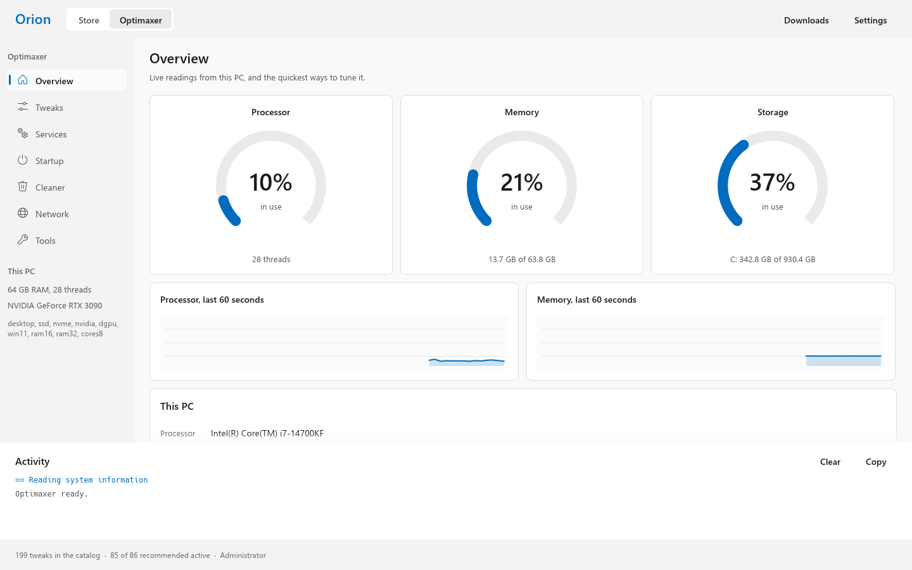 |
| 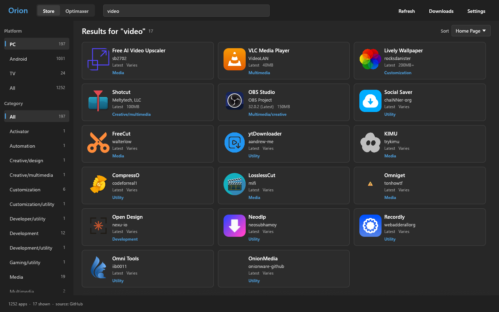 | 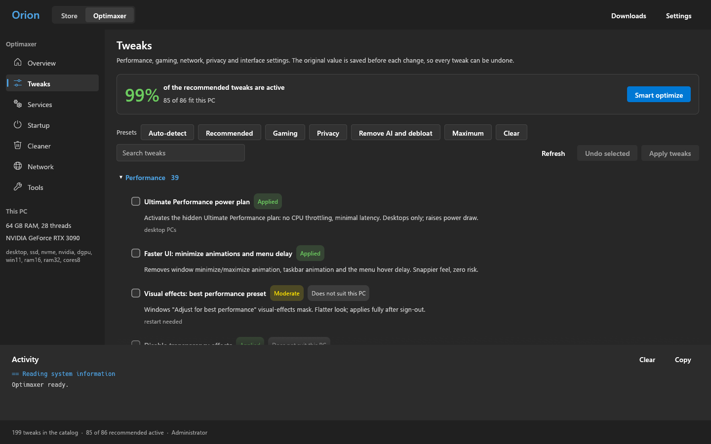 |
| 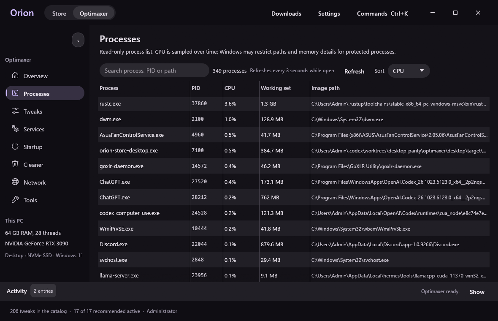 | 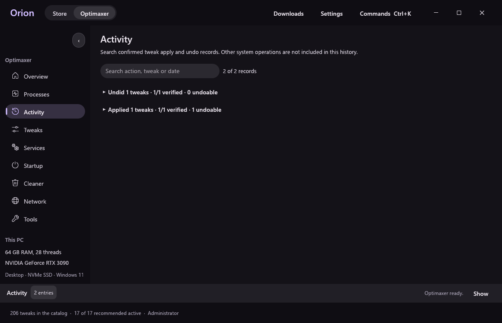 |
| 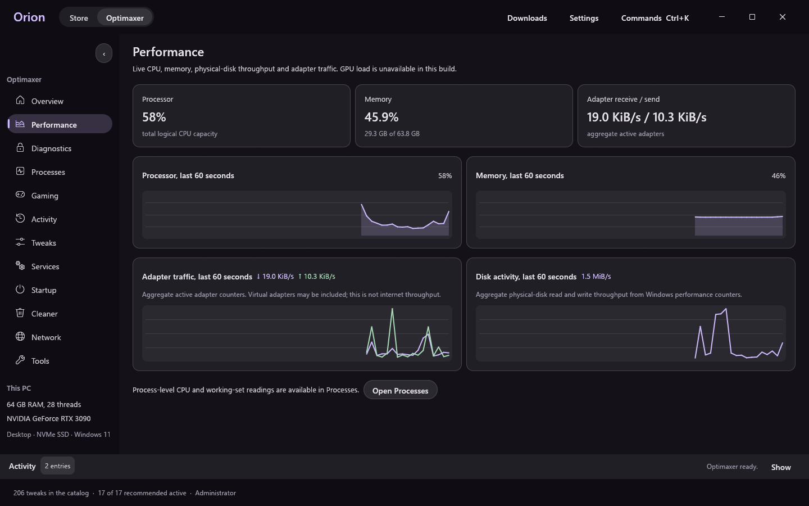 | 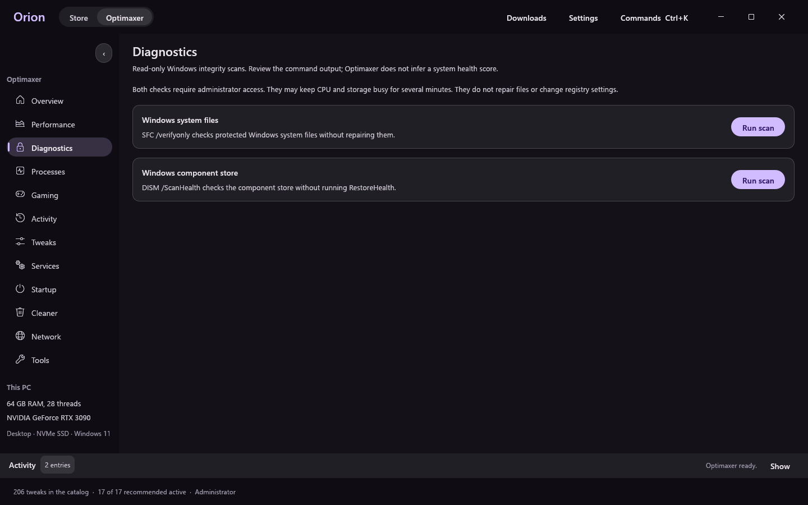 |
| 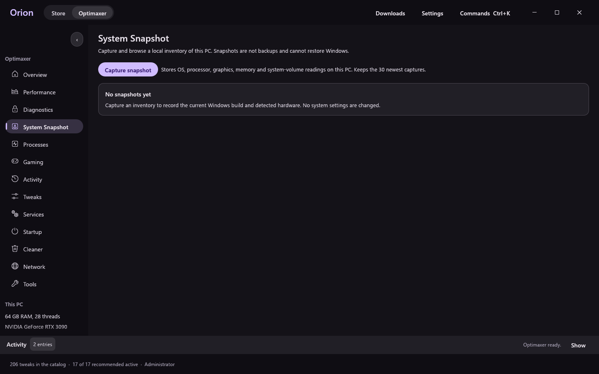 | |
| 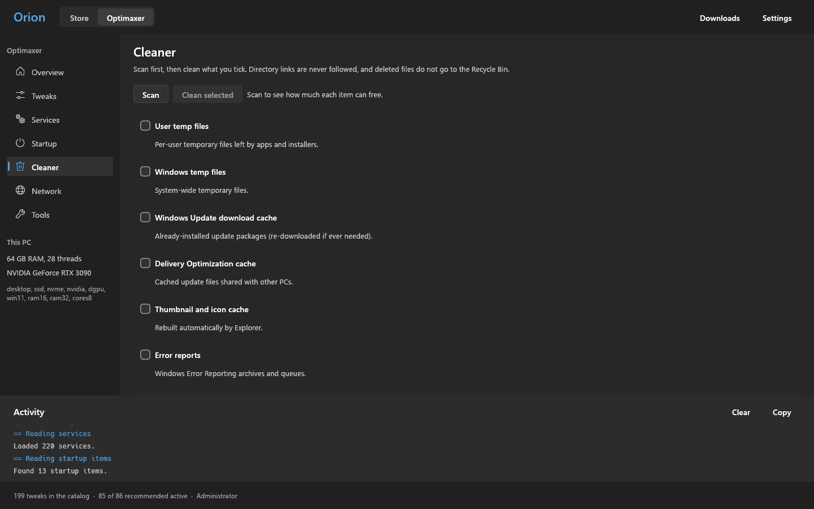 | |

**Optimaxer for PowerShell** (WPF, Windows 10 and 11):

| | |
|---|---|
| 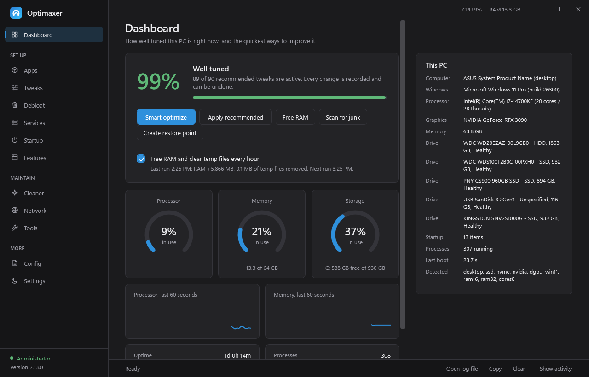 | 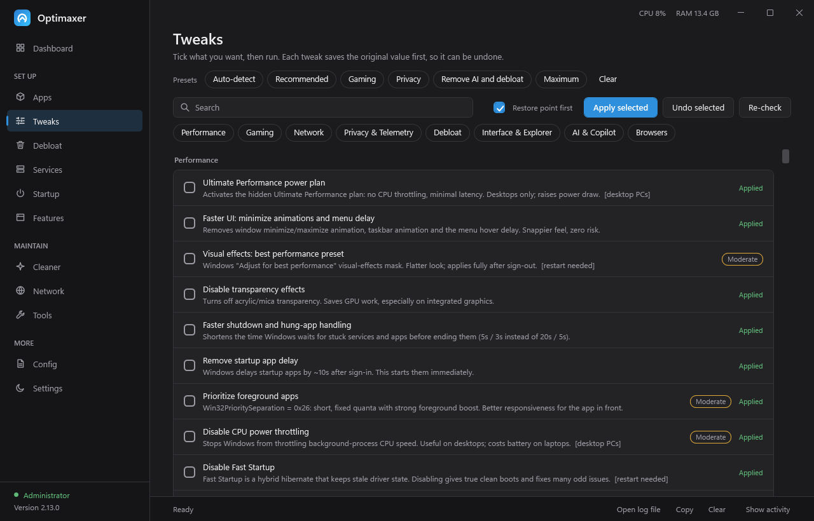 |
| 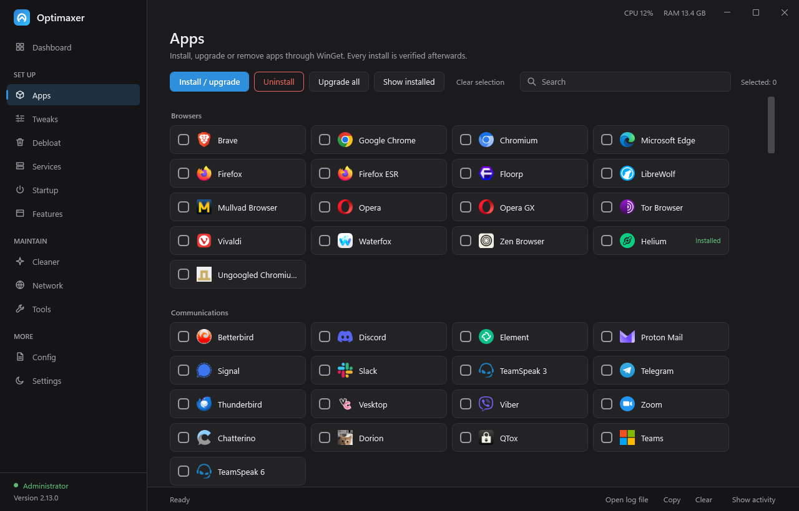 | 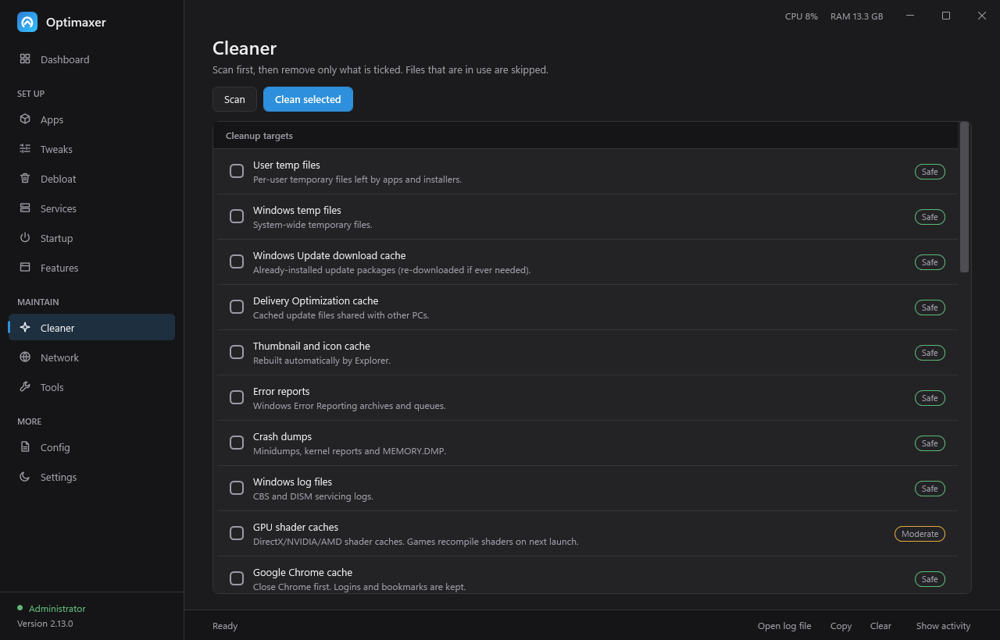 |

## Get it
**One line** (installs to `%LOCALAPPDATA%\Optimaxer`, adds desktop and Start menu shortcuts, starts the app; run again to update):

```powershell
irm https://raw.githubusercontent.com/bliper2/optimaxer/main/install.ps1 | iex
```

Or download the zip from [Releases](https://github.com/bliper2/optimaxer/releases), extract it and double-click `Launch.bat` (asks for administrator rights).

## What it does
- **Install**: 260+ apps in 10 categories through WinGet (the WinUtil list plus more), with real app icons, "Show installed", upgrade-all, and a verification step after every install or uninstall.
- **Tweaks**: 209 active tweaks plus 8 retired ones (performance, gaming, network, privacy, AI/Copilot/Recall removal, a safe OneDrive uninstall, browser debloat, Windows Update control, interface) with presets. Recommended is short on purpose: TRIM, last-access timestamps, startup delay, file extensions, widgets and feeds, Copilot, and the suggestion policies. Gaming is Game Mode, Game DVR capture off for your account, sticky-key popups and mouse acceleration. Tweaks that write the same setting (search box style, drive letters, taskbar grouping, All apps view, where Explorer opens) form a group, and only one per group can be ticked. The 2026 taskbar, Start, Explorer, Game Bar and Store-search modules follow [WinUtil](https://github.com/ChrisTitusTech/winutil) and [Win11Debloat](https://github.com/Raphire/Win11Debloat). The original value of everything a tweak touches is saved, so each tweak, and "Undo ALL", restores your real prior settings. Optional restore point first.
- **Smart optimize**: detects laptop or desktop, SSD/NVMe or HDD, RAM size, GPU and Windows version, then ticks the recommended set plus the **performance set** where it fits the hardware: on a desktop, CPU power throttling off, no USB/PCIe link sleep and per-app timer requests honored; with a discrete GPU, hardware-accelerated GPU scheduling; Game Mode and Game DVR capture off everywhere (Dashboard button, the Auto-detect chip on Tweaks, or `-Preset auto` unattended). Advanced tweaks are never ticked automatically, and neither are the Ultimate plan, 100% minimum CPU state or boot-configuration changes (heat, no measured gain). The Tweaks page says on every other row why it was left unticked (its risk, or the hardware fact such as "this PC is a laptop").
- **Retired tweaks**: 8 tweaks with no measurable effect on Windows 11, or whose keys Windows blocks even for administrators (icon cache size, NtfsMemoryUsage, svchost splitting, MFT zone, DisablePagingExecutive, the MMCSS network throttle, diagnostic tracing, Chat auto-install), are hidden and never ticked. If you applied one earlier it stays listed so you can undo it.
- **Tested on a real PC**: `tests\Live.Tests.ps1 -IUnderstand` makes a restore point, then applies and undoes every tweak that is not active on that PC (uninstalls without an undo and BitLocker, Windows Update, Remote Desktop, VBS and clock changes are skipped) and compares every touched value before and after. On the reference PC (i7-14700KF, RTX 3090, Windows 11) 61 of 67 applied and undid cleanly on the first run. The rest: three registry keys Windows protects even from administrators (fixed with a per-user key, or retired), a protected service (dropped from that tweak), Opera not installed (correctly not applied), and an engine bug where undoing one tweak cleared a value another applied tweak still needed (fixed in both editions).
- **Not recommended on Windows 11 (opt-in only)**: Prefetch/SysMain off, kernel paging, dynamic tick, 100% minimum processor state, Win32PrioritySeparation, global fullscreen-optimization and MPO workarounds, Nagle, the background-app ban, memory compression and Fault Tolerant Heap. They stay in the list, marked Advanced, with the reason in their description; none of them is in a preset.
- **Undo you can trust**: the original values are written to disk before the first change. Script tweaks (Nagle, the boot timer, power diagnostic logs) save every value they will touch, including "did not exist", and undo puts exactly that back. If any restore step fails, the saved record stays, the log names the step, and "Undo ALL" lists the tweaks it could not undo. If you asked for a restore point and Windows cannot make one, nothing is applied until you confirm; `-Silent` exits with code 3 instead.
- **Config**: export/import what you ticked on Install and Tweaks, create a desktop shortcut, and run unattended (see below).
- **Services**: ~240 services with recommended Manual/Disable lists, protected core services hidden, JSON backup before every change.
- **Startup**: registry, startup-folder **and scheduled-task** entries that run at logon/boot; enable or disable without uninstalling.
- **Cleaner**: scan, review targets grouped by cleanup type, preview up to 200 matched paths for one selected target, then confirm before cleaning Windows temp files, update/shader/browser/dev-tool caches, logs and other supported locations. System-managed targets disclose when Windows cannot show per-item paths.
- **Debloat**: curated Appx removal (Microsoft, OEM and game bloat) with safety levels.
- **Network**: DNS provider switch (+DoH), latency benchmark, stack reset; opt-in hosts-file telemetry block.
- **Features**: Hyper-V, WSL, Sandbox, .NET 3.5 and more.
- **Auto clean**: one checkbox on the Dashboard schedules an hourly background task (runs as SYSTEM, even with Optimaxer closed) that deletes temp files older than an hour. It does not touch memory: the standby list is Windows' file cache, and emptying it every hour only makes Windows read the same files again. Turning it off removes the task.
- **Tools**: Free RAM (clears every RAM cache Windows allows: process and system working sets, file cache, modified and standby lists including low priority, identical pages and the registry cache; on demand only, never on a schedule), TRIM/defrag, disk health, SFC, DISM, Windows Update reset, icon/Store cache, performance counters, registry backup, update check, System Restore, and:
  - **Boot cost**: the boot times Windows logged and the apps, services and drivers it flagged as slowing boot. You pick startup entries to turn off; the Startup page turns them back on.
  - **Per-game profile**: pick game .exe files to get the high-performance GPU and fullscreen optimizations off for those games only (replaces the global FSO and MPO workarounds). Undo removes only what it added and puts back values that were there before.
  - **Search: skip build folders**: excludes node_modules, .git, target and build folders in your profile from Windows Search. The indexer stays on.
  - **Wake sources**: lists devices and scheduled tasks that can wake the PC; you pick what to disarm, and running it again re-arms them. Windows Update and Defender tasks are never offered.
  - **Measure (before / after)**: real numbers from your PC. Tick a running game and Optimaxer records 30 seconds of its frames with [Intel PresentMon](https://github.com/GameTechDev/PresentMon) (MIT; downloaded from its GitHub release on first use and checked against the published SHA-256): average FPS, 1% and 0.1% lows, 99th-percentile frame time and stutters. Every run also records DPC and interrupt CPU time, the timer resolution, ping and jitter, and the last boot time. Measure before, optimize and restart, play the same scene, measure after: the Dashboard and the log show each number before and after and whether it got better or worse.
- **Appx removal** removes the provisioned copy too, and reports a package that is still provisioned for new accounts as not removed.
- **Settings**: match-Windows, Dark, Light, OLED, Nord, Graphite, Dusk, Porcelain, Material or Material light, a Windows accent that follows your own colour plus nine more, live dashboard gauges, reduced-motion option and update-check control.

## Linux (Manjaro, Arch and Fedora)
A separate, dependency-free Python edition lives in [`linux/`](linux/optimaxer.py). It works on Manjaro and other pacman-based distributions (EndeavourOS, Arch, Garuda...) and on Fedora and other dnf-based ones (Fedora Workstation and spins, Nobara, RHEL, Rocky, AlmaLinux). It picks the package manager from `/etc/os-release`.

```bash
curl -fsSL https://raw.githubusercontent.com/bliper2/optimaxer/main/linux/install.sh | bash
optimaxer               # opens the window on a desktop (optimaxer --text for the terminal menu)
optimaxer gui           # graphical window (needs Tk: sudo pacman -S tk, or sudo dnf install python3-tkinter); asks for your password
optimaxer --dry-run     # text menu, nothing is changed
optimaxer               # text menu, real run (asks for sudo)
```

The window (tkinter, no extra Python packages) has the same tabs as the Windows app: Home, Install, Tweaks with presets, Cleaner, Services, Startup, Debloat, Network, Tools, Config (export/import a selection, add an application-menu launcher) and Appearance (9 themes, including Material dark and light), plus a Dry run switch and a live log. `install.sh` adds Optimaxer to your application menu. If you downloaded `optimaxer-linux.py` by hand, run `python3 optimaxer-linux.py` once: it opens the window and, the first time in a terminal, offers to add the menu entry and an `optimaxer` command.

Sections: **Install apps** (97 apps from the official repos, the AUR through yay/paru, and Flatpak, each verified after install), **Tweaks** with presets and undo (zram, memory/swappiness, TRIM, I/O scheduler, journal limit, fast shutdown, earlyoom, BBR, pacman parallel downloads, paccache, hardening sysctls, optional ufw firewall, **browser debloat** for Firefox, Chromium, Chrome, Brave and Edge...), **Cleaner** (pacman cache, orphans, journal, caches of browsers/pip/npm/Go/Cargo, Trash, unused Flatpak runtimes), **Services**, **Startup** (user and system XDG `.desktop` autostart entries; system entries are changed through user-level override files), **Debloat packages**, **Network/DNS** (NetworkManager) and **Tools** (system info, update, Manjaro mirror ranking, failed units, .pacnew files, SMART health).

On Fedora the same sections work through dnf: apps come from the Fedora repositories or Flathub (the Flathub remote is added when it is missing; AUR-only apps and apps that need a third-party repository are not offered), there is a dnf tweak (parallel downloads and fastest mirror), the cleaner handles the dnf cache and unneeded packages, the update tool runs `dnf upgrade --refresh`, leftover-config search looks for `.rpmnew` and `.rpmsave` files, and the Arch-only tweaks (pacman, ufw; Fedora already runs firewalld) are hidden.

Non-interactive: `optimaxer tweaks list | apply --preset safe | undo --all`, `optimaxer apps install firefox brave-bin`, `optimaxer clean scan | run`, `optimaxer dns cloudflare | restore`, `optimaxer config apply my-setup.json`, `optimaxer launcher`, `optimaxer update`. Add `--dry-run` to see every command and file change first, `-y` to skip confirmations.

Safety: changes record their original state in `/var/lib/optimaxer/state.json` (files, config lines, service states, DNS) before mutation; edited config files are also copied to `/var/lib/optimaxer/backups`. Failed undo operations keep their saved originals for retry. Unreadable state blocks changes. Package installs by a tweak are kept on undo. Tests use a simulated system covering Arch and Fedora, including Tk controls (`python -B -m unittest discover -s linux/tests`). Real distribution integration still needs testing, so start with `--dry-run`.

## Desktop app (Rust)
[`desktop/`](desktop/) holds a single-exe Windows app that puts the [Orion Store](https://github.com/RookieEnough/Orion-Store) catalog and Optimaxer in one window (Rust, eframe/egui). The Optimaxer side ports 206 of 217 tweaks with shared undo records and hardware-aware Smart optimize, plus services, startup, cleaner, DNS, network tools and maintenance helpers. Overview shows live CPU, memory and disk gauges, recommends reviewing inactive eligible Smart Optimize settings, and offers a cleanup scan when measured system-drive use reaches 90%. Startup includes Run keys, Startup folders and third-party logon/boot tasks; Microsoft tasks are excluded. Activity searches confirmed tweak records and captured output from selected system actions in one chronological timeline; operation output does not prove final system state or provide undo data. The notification center surfaces restart, update, operation and download events. Settings combines Windows, Classic and Material control styles with 16 named color palettes, custom accent and editable light/dark surface colors, reduced motion, compact or comfortable density, adjustable interface scale and corner radius, and update controls. The command palette opens existing pages and actions. Performance can compare 30-second PresentMon captures, DPC and interrupt counters, timer resolution, TCP connect timings to a DNS endpoint, and the last Windows boot duration. Every system change opens a confirmation window listing what will change. The 11 tweaks that need PowerShell cmdlets stay in this edition. Download `OrionStore-Optimaxer-desktop-v*-win-x64.zip` from [Releases](https://github.com/bliper2/optimaxer/releases/latest), or build it with `cargo build --release` in `desktop/`. The desktop folder is GPL-3.0 (it derives from Orion Store); everything else here stays MIT. See [desktop/README.md](desktop/README.md) and [the edition comparison](docs/edition-comparison.md).

## Run unattended
```powershell
powershell -ExecutionPolicy Bypass -File Optimaxer.ps1 -Silent -Preset safe          # auto | safe | gaming | privacy | deai | max
powershell -ExecutionPolicy Bypass -File Optimaxer.ps1 -Silent -Config my-setup.json # from Config > Export selection
```
Add `-NoRestorePoint` to skip the restore point. Exit code 0 = everything verified, 1 = something was not applied, 2 = bad arguments.

## Safety model
- Every tweak snapshots the prior registry values, service start types and task states (`%ProgramData%\Optimaxer\state.json`). Several tweaks sharing a setting still undo correctly in any order.
- Tweaks that remove keys (context-menu entries) export them to a `.reg` backup first. The hosts block lives between marker lines and the file is backed up.
- Anything risky or irreversible is tagged Moderate/Advanced, and opt-in tweaks never appear in presets. Automatic plans never tick Advanced, opt-in or retired tweaks.
- Tests: `powershell -NoProfile -ExecutionPolicy Bypass -File tests\Optimaxer.Tests.ps1` (catalog rules, Smart optimize on a reference gaming desktop, undo records, restore-point refusal; writes only to a scratch registry key and %TEMP%).
- Logs: `%ProgramData%\Optimaxer\optimaxer.log`. Settings: `%ProgramData%\Optimaxer\settings.json`.

## Updates
Optimaxer checks GitHub Releases once per launch (Settings > Updates, or Tools > Check for updates). A newer release shows an **Update to vX** button in the title bar. Updating downloads the zip, verifies its published SHA-256, backs up the current files to `%ProgramData%\Optimaxer\backups\app-<version>-<time>`, swaps them in after the app closes and restarts. A git checkout is never overwritten (use `git pull`). For a private fork set `OPTIMAXER_TOKEN` to a GitHub token with read access.

## Development
Desktop app tests: `cargo test` in `desktop/`.
Linux edition tests: `python -m unittest discover -s linux/tests` (runs on any OS with a fake system).
GitHub Actions runs the PowerShell and Rust checks on Windows and the Linux tests on Windows and Linux. See [verification scope](docs/verification.md) for the distinction between automated coverage and real-system integration.
`Optimaxer.ps1 -NoElevate -Screenshot <dir>` renders every page to PNG. `tools/make-logo.ps1` builds `assets/optimaxer.ico` and the site favicon from `assets/logo.png`. The 16 px frame is `assets/logo-small.png`. Bump `VERSION` and include it in the release zip so the updater sees new releases.

## Credits
The desktop app's Store client and app catalog come from [Orion Store](https://github.com/RookieEnough/Orion-Store) by RookieEnough (GPL-3.0), with catalog data from [Orion-Data](https://github.com/RookieEnough/Orion-Data). Thank you to everyone who works on it.

Tweak ideas draw on [Win11Debloat](https://github.com/Raphire/Win11Debloat) (MIT) and [WinUtil](https://github.com/ChrisTitusTech/winutil) (MIT), plus general knowledge of AtlasOS-style tuning (AtlasOS is GPL-3.0; no code copied). The telemetry hosts list is [WindowsSpyBlocker](https://github.com/crazy-max/WindowsSpyBlocker) (MIT), fetched at apply time.

App icons are fetched at runtime (never bundled) from open icon packs served by jsDelivr and cached in `%ProgramData%\Optimaxer\icons4`: [selfh.st icons](https://selfh.st/icons/) (CC BY 4.0, attribution: selfh.st), [Dashboard Icons](https://github.com/homarr-labs/dashboard-icons) (Apache-2.0) and [Simple Icons](https://simpleicons.org) (CC0). Apps without a pack icon fall back to their product page's favicon (Google favicon service, as WinUtil does). Logos remain the trademarks of their owners.
